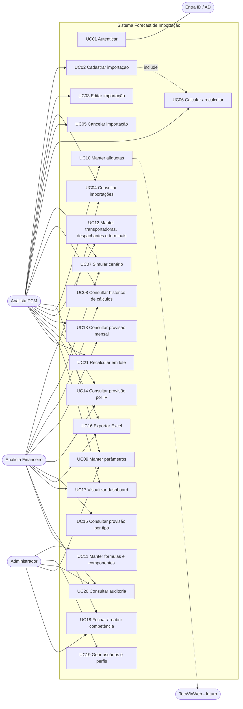

# 02. Casos de Uso

## 1. Atores

| Ator | Tipo |
|------|------|
| Analista PCM | Primário |
| Analista Financeiro | Primário |
| Administrador | Primário |
| Provedor de identidade (Entra ID/AD) | Sistema externo |
| TecWinWeb, ERP, PTAX/BCB | Sistemas externos (futuro) |
| Agendador | Sistema (rotinas como recálculo em lote e lembretes de fechamento) |

## 2. Diagrama de casos de uso

## 3. Especificações detalhadas

### UC02: Cadastrar importação
- Ator: Analista PCM
- Pré-condições: usuário autenticado com `importacao:criar`. Parâmetros vigentes cadastrados.
- Pós-condição: processo salvo em status RASCUNHO (ou CALCULADO, se o usuário pedir o cálculo), com registro na auditoria.

Fluxo principal:
1. O usuário acessa Importações > Nova.
2. O sistema exibe o formulário com valores padrão (moedas, tipo, despachante padrão do tipo).
3. O usuário informa o número da IP (opcional, texto livre), data da IP ou data prevista, tipo de importação, modal, invoice e moeda, frete e moeda, quantidade de itens e containers, taxas de câmbio, Siscomex, pesos, transportadora, despachante, terminal e observações.
4. O sistema valida os campos (RN01, RN19) e mostra prévia dos valores em BRL.
5. O usuário clica em "Salvar e calcular".
6. O sistema salva o processo e executa o UC06.
7. O sistema exibe o detalhe do processo com o resultado e a memória de cálculo.

Fluxos alternativos:
- 5a. "Salvar rascunho": salva sem calcular (status RASCUNHO).
- 4a. Número de IP duplicado: bloqueia e indica o processo existente.
- 4b. Moeda sem taxa informada: bloqueia e destaca o campo.
- 6a. Falta parâmetro vigente para algum componente: salva como RASCUNHO e lista as pendências.

### UC22: Fechar a despesa do processo
- Ator: Analista PCM (`importacao:editar`)
- Pré-condições: processo CALCULADO, sem recálculo pendente. Não confundir com o fechamento de competência (UC18).
- Pós-condição: processo FECHADO, com valor da fatura, número da fatura, data/hora e usuário do fechamento, e auditoria da alteração (RN23).

Fluxo principal:
1. No detalhe do processo, o usuário aciona "Fechar despesa".
2. O usuário informa o valor da fatura (maior que zero, 2 casas) e o número da fatura (até 60 caracteres).
3. O sistema valida os campos e a versão do processo (controle otimista).
4. O sistema grava o fechamento e o processo passa a FECHADO. A provisão não muda.

Fluxos alternativos:
- 3a. Processo em rascunho: orienta a calcular antes. Com recálculo pendente: orienta a recalcular antes.
- 3b. Processo já fechado ou cancelado: bloqueia.
- 3c. Outra pessoa alterou o processo (versão diferente): bloqueia e pede para recarregar.
- Depois de fechado, o processo não pode ser editado, recalculado nem cancelado.

### UC06: Calcular / recalcular importação
- Ator: Analista PCM (ou Agendador, em lote)
- Pré-condições: processo não cancelado e não fechado (UC22). Competência não fechada (RN17).
- Pós-condição: nova versão de cálculo vigente, anterior preservada (RN13).

Fluxo principal:
1. O usuário aciona "Calcular" no processo.
2. O sistema determina a data de referência e carrega os parâmetros, alíquotas e fórmulas vigentes.
3. O sistema executa o pipeline (doc 04) e gera um resultado por componente, com base, alíquota, valor e competência.
4. O sistema apresenta a prévia com as diferenças em relação à versão vigente.
5. O usuário confirma, informando o motivo quando se trata de recálculo.
6. O sistema grava a nova versão (snapshot de entradas + parâmetros + memória), marca como vigente e audita.

Fluxos alternativos:
- 3a. Erro de fórmula (divisão por zero, variável inexistente): aborta, não grava e exibe o componente com erro.
- 5a. O usuário cancela: nada é gravado.
- 1a. Competência fechada: bloqueia e orienta a solicitar reabertura (UC18).

### UC07: Simular cenário
- Ator: PCM ou Financeiro
- Pós-condição: cenário salvo (opcional) como cálculo do tipo SIMULACAO, sem efeito na provisão (RN15).

Fluxo principal:
1. A partir de um processo (ou em branco), o usuário abre "Simular".
2. O usuário altera variáveis: câmbio, alíquotas, quantidade de containers, parâmetros.
3. O sistema recalcula em tempo real e mostra a comparação "vigente × cenário" por componente.
4. O usuário pode salvar o cenário com nome, exportar ou descartar.

Alternativo:
- 4a. Promover cenário (somente PCM): converte as entradas do cenário em alterações do processo e executa o UC06.

### UC13: Consultar provisão mensal
- Ator: Financeiro, PCM
- Fluxo principal:
  1. O usuário seleciona o intervalo de competências e filtros (tipo, status, transportadora).
  2. O sistema consolida as versões vigentes dos processos não cancelados por competência × componente, considerando apenas componentes que compõem o desembolso (RN20).
  3. O sistema mostra a tabela dinâmica com totais e permite detalhar até o processo.
  4. O usuário pode exportar (UC16).
- Alternativo: se a competência estiver fechada, o sistema exibe o snapshot do fechamento e sinaliza diferenças em relação ao cálculo atual, se houver.

### UC18: Fechar / reabrir competência
- Ator: Financeiro (fechar), Administrador/Financeiro gestor (reabrir)
- Fluxo principal (fechar):
  1. O usuário seleciona a competência.
  2. O sistema lista os processos em RASCUNHO ou com pendências.
  3. O usuário confirma.
  4. O sistema grava o snapshot da provisão, marca a competência como FECHADA e audita.
- Reabrir: exige motivo. O snapshot anterior fica preservado e um novo é criado no próximo fechamento.

### UC11: Manter fórmulas e componentes
- Ator: Administrador
- Fluxo principal:
  1. O Admin seleciona o componente e cria uma nova versão da fórmula.
  2. O sistema valida a sintaxe e as variáveis permitidas (lista branca) e detecta dependências circulares.
  3. O Admin executa o teste com casos de referência (golden cases). O sistema mostra o resultado esperado × obtido.
  4. O Admin define a vigência e submete.
  5. Um segundo aprovador (PCM gestor ou Fiscal) aprova. A fórmula é publicada (princípio dos 4 olhos).
- Alternativo: reprovação, a versão volta para rascunho com comentário.

### UC21: Recalcular em lote
- Ator: PCM
- Fluxo principal:
  1. Após alterar um parâmetro, o sistema oferece "Avaliar impacto".
  2. O sistema lista os processos abertos afetados, com a diferença estimada por processo.
  3. O usuário seleciona os processos e confirma.
  4. O sistema gera novas versões com motivo comum e audita.

## 4. Casos de uso de menor complexidade (resumo)

| UC | Descrição | Regras principais |
|----|-----------|-------------------|
| UC01 Autenticar | Login via SSO (OIDC). Perfis mapeados por grupos do AD ou atribuídos no sistema | RNF03 |
| UC03 Editar importação | Igual ao UC02, com controle de versão otimista. Alterações em processo calculado sinalizam "cálculo desatualizado" | RN17 |
| UC04 Consultar | Lista com filtros, ordenação, paginação e indicadores de status | – |
| UC05 Cancelar | Exige motivo. Remove da provisão. Não cancela processo FECHADO | RN16, RN23 |
| UC08 Histórico de cálculos | Lista versões com usuário, data, motivo e total. Comparação entre duas versões | RN13 |
| UC09 Manter parâmetros | Novo valor cria nova vigência e encerra a anterior. Não há edição retroativa sem permissão especial | RN14 |
| UC10 Manter alíquotas | Por imposto, tipo de importação e (opcional) NCM. Origem manual/TecWin | RN03 |
| UC12 Cadastros de apoio | Transportadoras, despachantes e terminais com suas tabelas de valores e vigência | RN07–RN11 |
| UC14 / UC15 Provisão por IP / tipo | Visões do UC13 agrupadas por processo ou tipo | RN20 |
| UC16 Exportar Excel | Exporta a visão atual com cabeçalho (filtros, data, usuário) e valores numéricos (não texto) | – |
| UC17 Dashboard | Gráficos e KPIs sobre as versões vigentes | – |
| UC19 Usuários e perfis | Ativar/inativar, atribuir perfis. Nunca excluir fisicamente | RNF04 |
| UC20 Auditoria | Busca por entidade, usuário e período. Mostra diff antes/depois | RNF04 |
