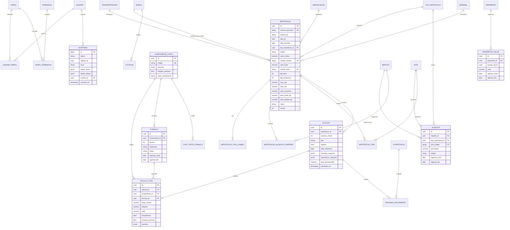

# 03. Modelo de Dados

## 1. Princípios de modelagem

- Valores monetários em `NUMERIC(18,2)`, taxas de câmbio em `NUMERIC(18,6)` e percentuais/alíquotas em `NUMERIC(9,6)` (ex.: 0,092000 = 9,2%).
- Chaves primárias `UUID` (preferencialmente v7, ordenável), que não expõem a sequência na API.
- Parâmetros com vigência (`vigencia_inicio`, `vigencia_fim`), sem sobreposição. Isso é garantido por constraint `EXCLUDE USING gist` no PostgreSQL.
- Cálculos imutáveis: nada é atualizado, só inserido. Uma nova versão substitui a vigente.
- Snapshot em `JSONB` das entradas e parâmetros usados em cada cálculo (rastreabilidade sem depender de joins históricos).
- Exclusão lógica (`ativo`, `cancelado_em`) em cadastros e processos.
- Colunas padrão em todas as tabelas: `criado_em`, `criado_por`, `atualizado_em`, `atualizado_por` e `versao` (lock otimista nas tabelas editáveis).

## 2. Entidades

### 2.1 Segurança

| Entidade | Atributos principais | Observações |
|----------|----------------------|-------------|
| `usuario` | id, nome, email (UK), id_externo (sub do IdP), ativo, ultimo_acesso | Identidade vem do SSO |
| `perfil` | id, codigo (UK: PCM, FINANCEIRO, ADMIN...), nome | |
| `permissao` | id, codigo (UK: `importacao:criar`...), descricao | |
| `usuario_perfil` | usuario_id, perfil_id | N:N |
| `perfil_permissao` | perfil_id, permissao_id | N:N |

### 2.2 Cadastros de apoio

| Entidade | Atributos principais | Observações |
|----------|----------------------|-------------|
| `tipo_importacao` | id, codigo (USO_CONSUMO, INDUSTRIALIZACAO, ADICIONAR_ATIVO), nome, ativo | Extensível |
| `moeda` | codigo (PK: BRL, USD, CNY, EUR), nome, simbolo | ISO 4217 |
| `cotacao` | id, moeda_codigo, data, taxa, fonte (MANUAL, PTAX) | Base para sugerir taxas. O processo guarda a taxa efetivamente usada |
| `transportadora` | id, nome, cnpj, tipo_servico (LOCAL), ativo | Só transporte local. O transporte secundário foi removido |
| `despachante` | id, nome, cnpj, ativo | |
| `terminal` | id, nome (ex.: Chibatão), modal, ativo | Armazenagem |
| `ncm` (opcional) | codigo (PK), descricao | Para alíquotas por NCM |

### 2.3 Parametrização

| Entidade | Atributos principais | Observações |
|----------|----------------------|-------------|
| `parametro` | id, chave (ex.: `tcif.valor_item`), descricao, tipo_valor (MONETARIO, PERCENTUAL, INTEIRO, BOOLEANO, TEXTO), escopo (GLOBAL, TIPO_IMPORTACAO, TRANSPORTADORA, DESPACHANTE, TERMINAL) | Definição |
| `parametro_valor` | id, parametro_id, escopo_ref_id (nullable), valor, vigencia_inicio, vigencia_fim, justificativa | Valor com vigência. Ex.: `despachante_honorario_ip` = 715 para INDUSTRIALIZACAO. BOOLEANO guarda 0 ou 1 (ex.: `ii_suspenso`) |
| `imposto` | id, codigo (II, IPI, PIS, COFINS, ICMS, CBS, IBS...), nome, ativo | "Outros impostos" sem código novo |
| `aliquota` | id, imposto_id, tipo_importacao_id, ncm_codigo (nullable), percentual, origem (MANUAL, TECWIN), vigencia_inicio, vigencia_fim, referencia_externa | |
| `componente_custo` | id, codigo (CIF, II, TCIF, TRANSP_LOCAL...), nome, natureza (BASE, IMPOSTO, TAXA, SERVICO), compoe_provisao (bool), regra_competencia (MES_REFERENCIA, CORTE_DIA, MES_PREVISTO), ordem_exibicao, ativo | RN20 |
| `formula` | id, componente_id, versao, expressao, aplica_tipo_importacao_id (nullable), aplica_modal (nullable), status (RASCUNHO, APROVADA, PUBLICADA, REVOGADA), vigencia_inicio, vigencia_fim, aprovado_por, aprovado_em | Versionada, com 4 olhos |
| `caso_teste_formula` | id, componente_id, nome, entradas (JSONB), resultado_esperado | Golden cases |

### 2.4 Processo de importação

| Entidade | Atributos principais | Observações |
|----------|----------------------|-------------|
| `importacao` | id, numero_processo (UK, sequencial interno), numero_ip (UK parcial quando não nulo; texto livre de até 30 caracteres), data_ip, data_prevista, tipo_importacao_id, modal (MARITIMO, AEREO, RODOVIARIO), valor_invoice, moeda_invoice, valor_frete, moeda_frete, valor_seguro, moeda_seguro, qtd_itens, qtd_containers, taxa_usd, taxa_cny, valor_siscomex, valor_taxa_liberacao, peso_bruto_kg, peso_liquido_kg, transportadora_local_id, despachante_id, terminal_id, status, motivo_cancelamento, observacoes, versao | Taxas USD/CNY ficam explícitas conforme os requisitos. Para outras moedas usar `importacao_taxa_cambio` |
| `importacao_taxa_cambio` | importacao_id, moeda_codigo, taxa | Generalização para moedas futuras (opcional no MVP) |
| `importacao_aliquota_override` | id, importacao_id, imposto_id, percentual, justificativa | Exceções por processo |
| `importacao_item` (fase 2) | id, importacao_id, ncm_codigo, descricao, quantidade, valor_moeda | Para alíquotas por NCM / adições |

Status do processo: `RASCUNHO → CALCULADO → (PROVISIONADO*) → REALIZADO (fase 2)`, e `CANCELADO` a partir de qualquer status anterior a REALIZADO.
(*) PROVISIONADO = incluído em competência fechada.

### 2.5 Cálculo e provisão

| Entidade | Atributos principais | Observações |
|----------|----------------------|-------------|
| `calculo` | id, importacao_id, numero_versao, tipo (OFICIAL, SIMULACAO), nome_cenario, vigente (bool), data_referencia, motivo, entradas_snapshot (JSONB), parametros_snapshot (JSONB), total_provisionado, calculado_por, calculado_em, hash_integridade | Índice único parcial: um `vigente = true` por importação e tipo OFICIAL |
| `calculo_item` | id, calculo_id, componente_id, formula_id, formula_expressao, base_calculo, aliquota, valor, competencia (date, 1º dia do mês), compoe_provisao, memoria (JSONB) | Uma linha por componente |
| `competencia` | id, mes (date, UK), status (ABERTA, FECHADA), fechada_por, fechada_em, reaberta_por, reaberta_em, motivo_reabertura | |
| `provisao_fechamento` | id, competencia_id, importacao_id, calculo_id, componente_id, valor | Snapshot congelado no fechamento |

A provisão "viva" é uma view (`vw_provisao`) sobre `calculo_item` dos cálculos OFICIAIS vigentes de processos não cancelados, onde `compoe_provisao = true`. Os relatórios de competências fechadas leem de `provisao_fechamento`.

### 2.6 Auditoria e sistema

| Entidade | Atributos principais | Observações |
|----------|----------------------|-------------|
| `auditoria` | id (bigserial), tabela, registro_id, acao (INSERT, UPDATE, DELETE), dados_antes (JSONB), dados_depois (JSONB), campos_alterados (text[]), usuario_id, ip, correlation_id, ocorrido_em | Append-only. Particionar por mês quando crescer |
| `evento_negocio` | id, tipo (CALCULO_EXECUTADO, COMPETENCIA_FECHADA, ...), entidade, entidade_id, payload (JSONB), usuario_id, ocorrido_em | Eventos semânticos (auditoria funcional) |
| `configuracao` | chave (PK), valor (JSONB), descricao | Ex.: arredondamento, dia de corte padrão |
| `integracao_log` (futuro) | id, sistema (TECWIN, ERP, PTAX), operacao, status, request, response, ocorrido_em | |

## 3. Modelo ER



## 4. Constraints e índices relevantes

```sql
-- Vigências sem sobreposição para o mesmo parâmetro/escopo
CREATE EXTENSION IF NOT EXISTS btree_gist;
ALTER TABLE parametro_valor ADD CONSTRAINT parametro_valor_sem_sobreposicao
  EXCLUDE USING gist (
    parametro_id WITH =,
    coalesce(escopo_ref_id, '00000000-0000-0000-0000-000000000000'::uuid) WITH =,
    daterange(vigencia_inicio, vigencia_fim, '[)') WITH &&
  );

-- Um único cálculo oficial vigente por importação
CREATE UNIQUE INDEX ux_calculo_vigente
  ON calculo (importacao_id)
  WHERE vigente AND tipo = 'OFICIAL';

-- Número da IP único quando informado
CREATE UNIQUE INDEX ux_importacao_ip
  ON importacao (numero_ip)
  WHERE numero_ip IS NOT NULL;

-- Relatórios de provisão
CREATE INDEX ix_calculo_item_competencia ON calculo_item (competencia, componente_id);
```

## 5. Auditoria no banco

Recomenda-se uma trigger genérica de auditoria em todas as tabelas de negócio. O usuário da aplicação é propagado por variável de sessão em cada transação, assim nada escapa da trilha, nem alteração feita fora da API:

```sql
-- Definido pela aplicação no início de cada transação
SELECT set_config('app.usuario_id', :usuario_id, true);
SELECT set_config('app.correlation_id', :correlation_id, true);
```

A trigger lê `current_setting('app.usuario_id', true)` e grava `to_jsonb(OLD)` e `to_jsonb(NEW)` em `auditoria`. O usuário de banco da aplicação só tem `INSERT` em `auditoria` (sem `UPDATE`/`DELETE`).
