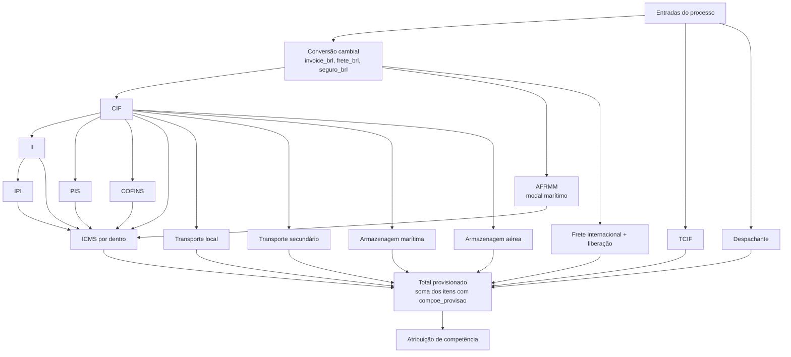

# 04. Motor de Cálculo

O motor é o núcleo do sistema e o maior risco de negócio. Ele deve ser um módulo de domínio puro (sem banco, sem HTTP): recebe entradas + parâmetros e devolve resultados + memória. Isso o torna determinístico, testável e reutilizável para cálculo oficial, simulação e recálculo em lote.

## 1. Pipeline

Os componentes formam um grafo de dependências. O motor ordena topologicamente as fórmulas e rejeita ciclos no momento da publicação.



## 2. Dicionário de variáveis (lista branca)

| Variável | Origem |
|----------|--------|
| `invoice_brl`, `frete_brl`, `seguro_brl` | Valor × taxa da moeda (RN01) |
| `valor_invoice`, `valor_frete`, `taxa_usd`, `taxa_cny` | Entrada |
| `siscomex`, `qtd_itens`, `qtd_containers`, `peso_bruto`, `peso_liquido` | Entrada |
| `modal`, `tipo_importacao` | Entrada (texto, para condições) |
| `cif`, `ii`, `ipi`, `pis`, `cofins`, `afrmm`, `icms`, ... | Resultado de componentes anteriores |
| `valor_carga` | Alias configurável (padrão: `cif`), pendente de confirmação |
| `aliq.<imposto>` | Alíquota vigente (ou override do processo) |
| `p.<chave>` | Parâmetro vigente resolvido no escopo do processo (tipo, transportadora, despachante, terminal) |

Funções permitidas: `min`, `max`, `round`, `se(cond, a, b)`, `arred(x, casas)`. Nada além disso.

## 3. Fórmulas padrão (versão 1)

As fórmulas de impostos são uma proposta baseada na sistemática usual de importação e precisam ser validadas pelo Fiscal, especialmente por causa dos benefícios da ZFM por tipo de importação.

| Componente | Expressão padrão | Provisão | Competência |
|------------|------------------|----------|-------------|
| CIF | `invoice_brl + frete_brl + siscomex` | Não (base) | – |
| II | `cif * aliq.ii` | Sim | Mês da DI |
| IPI | `(cif + ii) * aliq.ipi` | Sim | Mês da DI |
| PIS | `cif * aliq.pis` | Sim | Mês da DI |
| COFINS | `cif * aliq.cofins` | Sim | Mês da DI |
| AFRMM | `se(modal == 'MARITIMO', frete_brl * p.afrmm_percentual, 0)` | Sim | Mês da DI |
| ICMS | `(cif + ii + ipi + pis + cofins + afrmm + p.icms_outras_despesas) / (1 - aliq.icms) * aliq.icms` | Sim | Mês da DI |
| TCIF | `qtd_itens * p.tcif_valor_item + p.tcif_valor_di` | Sim | Corte dia 15 |
| Transporte local | `qtd_containers * p.tl_valor_container + valor_carga * p.tl_percentual` | Sim | Mês da DI |
| Transporte secundário | `qtd_containers * p.ts_valor_container + valor_carga * p.ts_percentual` | Sim | Mês da DI |
| Armazenagem marítima | `se(modal == 'MARITIMO', max(cif * p.arm_mar_pct_periodo1, p.arm_mar_minimo), 0)` | Sim | Mês da DI |
| Armazenagem aérea | Pendente. Até a definição: `p.arm_aerea_valor_manual` | Sim | Mês da DI |
| Despachante | `p.despachante_honorario_di` | Sim | Mês da DI |
| Frete internacional | `frete_brl + p.taxa_liberacao` | A confirmar | Mês da DI |

Valores iniciais dos parâmetros:

| Chave | Escopo | Valor inicial |
|-------|--------|---------------|
| `tcif_valor_item` | Global | 45,00 |
| `tcif_valor_di` | Global | 245,00 |
| `competencia_dia_corte` | Global | 15 |
| `tl_valor_container` | Transportadora | a cadastrar |
| `tl_percentual` | Transportadora | 0,0006 (0,06%) |
| `ts_valor_container` | Transportadora | 1.000,00 |
| `ts_percentual` | Transportadora | 0,0001 (0,01%) |
| `arm_mar_pct_periodo1` | Terminal | 0,0092 (0,92%) |
| `arm_mar_minimo` | Terminal | 0 (a confirmar) |
| `despachante_honorario_di` | Despachante × tipo | 715,00 (Industrialização) / 900,00 (Uso e Consumo) |
| `afrmm_percentual` | Global | 0,08 (validar com Fiscal) |
| `taxa_liberacao` | Global/agente | a cadastrar |

Atenção a dois pontos:
- Como o CIF atual já inclui o Siscomex, a fórmula do ICMS não soma o Siscomex de novo. Se o Fiscal decidir tirar o Siscomex do CIF, as duas fórmulas mudam juntas (nova versão de ambas).
- O frete aparece no CIF (base) e no componente "Frete internacional" (desembolso). Por isso o total soma apenas itens com `compoe_provisao = true` (RN20).

## 4. Regra de competência

```python
def competencia(data_ref: date, regra: RegraCompetencia, dia_corte: int) -> date:
    """Retorna o 1º dia do mês de competência."""
    inicio_mes = data_ref.replace(day=1)
    if regra is RegraCompetencia.CORTE_DIA and data_ref.day > dia_corte:
        return inicio_mes + relativedelta(months=1)
    return inicio_mes
```

`data_ref` = data da DI. Se ainda não houver DI, usa a data prevista. Isso define a competência inicial. Quando a DI for registrada, o recálculo pode mover a competência, e a mudança fica visível na comparação de versões.

## 5. Avaliação segura de fórmulas

- Nunca usar `eval`/`exec` do Python.
- Usar um avaliador de expressões restrito: parser AST com lista branca de nós (números, nomes, operadores aritméticos, comparação, chamadas às funções permitidas) ou uma biblioteca como `simpleeval`, configurada sem atributos nem funções além da lista.
- Todos os números entram como `Decimal`. O contexto decimal usa precisão de 28 dígitos e `ROUND_HALF_UP`.
- Validação na publicação: sintaxe, variáveis existentes, ausência de ciclos e execução dos casos de teste do componente.

## 6. Estratégia: fórmula × código

| Abordagem | Uso |
|-----------|-----|
| Expressão parametrizada (tabela `formula`) | CIF, impostos, TCIF, transportes, despachante, frete. Cobre o requisito "fórmula pode ser alterada" |
| Estratégia em código + parâmetros | Casos com lógica de tabela/faixas (armazenagem por períodos e faixas de peso, regras do Chibatão). Plugável via registro de estratégias, referenciada por `componente_custo.estrategia` |

Um editor de fórmulas genérico demais vira uma "planilha dentro do sistema" e perde a governança. A combinação acima mantém flexibilidade com testes.

## 7. Memória de cálculo

Cada `calculo_item.memoria` guarda o suficiente para reproduzir e explicar o valor:

```json
{
  "componente": "ICMS",
  "formula_versao": 1,
  "expressao": "(cif + ii + ipi + pis + cofins + afrmm + p.icms_outras_despesas) / (1 - aliq.icms) * aliq.icms",
  "variaveis": {
    "cif": "152340.55", "ii": "0.00", "ipi": "0.00",
    "pis": "3199.15", "cofins": "14700.86", "afrmm": "1230.40",
    "p.icms_outras_despesas": "0.00", "aliq.icms": "0.180000"
  },
  "origem_aliquota": {"aliq.icms": "TABELA vigente desde 2026-01-01"},
  "valor_bruto": "37639.9668...",
  "valor": "37639.97",
  "competencia": "2026-10-01"
}
```

(Valores ilustrativos.)

O `calculo.hash_integridade` (SHA-256 das entradas, parâmetros e resultados) permite detectar adulteração.

## 8. Estratégia de testes do motor

1. Golden cases: coletar de 20 a 30 processos reais já calculados nas planilhas (os dois tipos, os dois modais, DI antes e depois do dia 15, moedas USD e CNY). Eles viram testes automatizados com tolerância de R$ 0,01 por componente.
2. Testes unitários por componente e pela regra de competência (dias 15, 16, 31, virada de ano).
3. Testes de propriedade (Hypothesis): valores nunca negativos, monotonicidade (mais containers não reduz o custo), determinismo.
4. Período paralelo: 1 a 2 ciclos de fechamento rodando sistema e planilha juntos, com relatório de divergências.
