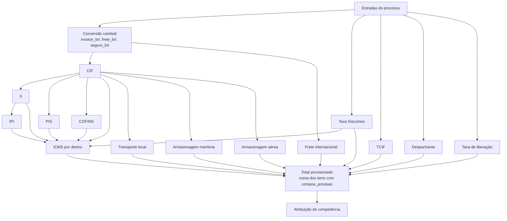

# 04. Motor de Cálculo

O motor é o núcleo do sistema e o maior risco de negócio. Ele deve ser um módulo de domínio puro (sem banco, sem HTTP): recebe entradas + parâmetros e devolve resultados + memória. Isso o torna determinístico, testável e reutilizável para cálculo oficial, simulação e recálculo em lote.

## 1. Pipeline

Os componentes formam um grafo de dependências. O motor ordena topologicamente as fórmulas e rejeita ciclos no momento da publicação.



## 2. Dicionário de variáveis (lista branca)

| Variável | Origem |
|----------|--------|
| `invoice_brl`, `frete_brl`, `seguro_brl` | Valor × taxa da moeda (RN01) |
| `valor_invoice`, `valor_frete`, `taxa_usd`, `taxa_cny` | Entrada |
| `siscomex` (valor informado; 0 = calcular), `valor_taxa_liberacao`, `qtd_itens`, `qtd_containers`, `peso_bruto`, `peso_liquido` | Entrada |
| `modal`, `tipo_importacao` | Entrada (texto, para condições) |
| `cif`, `ii`, `ipi`, `pis`, `cofins`, `icms`, ... | Resultado de componentes anteriores |
| `valor_carga` | Alias configurável (padrão: `cif`), pendente de confirmação |
| `aliq.<imposto>` | Alíquota vigente (ou override do processo) |
| `p.<chave>` | Parâmetro vigente resolvido no escopo do processo (tipo, transportadora, despachante, terminal) |

Funções permitidas: `min`, `max`, `round`, `se(cond, a, b)`, `arred(x, casas)`. Nada além disso.

## 3. Fórmulas padrão (versão 1)

As fórmulas de impostos são uma proposta baseada na sistemática usual de importação e precisam ser validadas pelo Fiscal, especialmente por causa dos benefícios da ZFM por tipo de importação.

| Componente | Expressão padrão | Provisão | Competência |
|------------|------------------|----------|-------------|
| CIF | `invoice_brl + frete_brl` (valor aduaneiro, sem Siscomex) | Não (base) | – |
| II | `se(p.ii_suspenso == 1, 0, cif * aliq.ii)` | Sim | Mês da IP |
| IPI | `se(p.ipi_suspenso == 1, 0, (cif + ii) * aliq.ipi)` | Sim | Mês da IP |
| PIS | `cif * aliq.pis` | Sim | Mês da IP |
| COFINS | `cif * aliq.cofins` | Sim | Mês da IP |
| Taxa Siscomex | `se(siscomex > 0, siscomex, p.siscomex_registro + <adições por faixa>)`, ver abaixo | Sim | Mês da IP |
| ICMS | `(cif + taxa_siscomex + ii + ipi + pis + cofins) / (1 - aliq.icms) * aliq.icms` | Sim | Mês da IP |
| TCIF | `qtd_itens * p.tcif_valor_item + p.tcif_valor_ip` | Sim | Corte dia 15 |
| Transporte local | `qtd_containers * p.tl_valor_container + valor_carga * p.tl_percentual` | Sim | Mês da IP |
| Armazenagem marítima | `se(modal == 'MARITIMO', max((cif * p.arm_mar_pct_periodo1 + qtd_containers * p.arm_mar_taxas_container + p.arm_mar_pesagem + p.arm_mar_infra + p.arm_mar_isps + p.arm_mar_seguro + p.arm_mar_inspecao + p.arm_mar_servicos_adm) / (1 - p.arm_mar_pct_impostos), p.arm_mar_minimo), 0)` | Sim | Mês da IP |
| Armazenagem aérea | `se(modal == 'AEREO', se(arm_aerea_manual > 0, arm_aerea_manual, cif * p.arm_aer_pct + max(peso_bruto * p.arm_aer_taxa_kg, p.arm_aer_minimo_peso)), 0)` | Sim | Mês da IP |
| Despachante | `p.despachante_honorario_ip` | Sim | Mês da IP |
| Frete internacional | `frete_brl` | Sim | Mês da IP |
| Taxa de liberação | `valor_taxa_liberacao` (informada em cada processo) | Sim | Mês da IP |

Valores iniciais dos parâmetros:

| Chave | Escopo | Valor inicial |
|-------|--------|---------------|
| `tcif_valor_item` | Global | 45,00 |
| `tcif_valor_ip` | Global | 250,00 (Lei 13.451/2017, art. 8º, § 2º) |
| `competencia_dia_corte` | Global | 15 |
| `tl_valor_container` | Transportadora | a cadastrar |
| `tl_percentual` | Transportadora | 0,0006 (0,06%) |
| `arm_mar_pct_periodo1` | Terminal | 0,0092 (0,92%) |
| `arm_mar_minimo` | Terminal | 0 (a confirmar) |
| `arm_mar_taxas_container` | Terminal | Padrão 0. Santos Brasil 1.023,02 (por container) |
| `arm_mar_pesagem`, `arm_mar_infra`, `arm_mar_isps`, `arm_mar_seguro`, `arm_mar_inspecao`, `arm_mar_servicos_adm` | Terminal | Padrão 0. Serviços portuários fixos por processo, sem multiplicar por container. Chibatão: 130,02 / 570,66 / 99,68 / 97,65 / 469,53 / 77,22 (total 1.444,76). Superterminais: 160,28 / 715,36 / 122,12 / 97,65 / 584,70 / 50,38 (total 1.730,49) |
| `arm_mar_pct_impostos` | Terminal | Padrão 0. Santos Brasil 0,1425 (PIS/COFINS + ISS embutidos: tarifa ÷ 0,8575) |
| `arm_aer_pct` | Terminal | 0,0165 (1,65% do CIF) |
| `arm_aer_taxa_kg` | Terminal | 0,25 por kg de peso bruto (Manaus). São Paulo: 0,0612 |
| `arm_aer_minimo_peso` | Terminal | 20,41 (mínimo da tarifa de peso) |
| `despachante_honorario_ip` | Despachante × tipo | 715,00 (Industrialização) / 900,00 (Uso e Consumo e Adicionar Ativo) |
| `siscomex_registro` | Global | 115,67 (por DI/Duimp) |
| `siscomex_adicao_faixa1` a `faixa6` | Global | 38,56 / 30,85 / 23,14 / 15,42 / 7,71 / 3,86 (por adição: 1ª-2ª, 3ª-5ª, 6ª-10ª, 11ª-20ª, 21ª-50ª, 51ª em diante) |
| `ii_suspenso` | Tipo de importação | 1 (suspenso, não paga). Booleano: 0 ou 1 |
| `ipi_suspenso` | Tipo de importação | 1 (suspenso, não paga). Booleano: 0 ou 1 |

Atenção a estes pontos:
- Taxa Siscomex automática: como o sistema é de provisão, o valor real ainda não existe. Se o campo "Taxa Siscomex" do processo ficar vazio (0), o motor calcula `siscomex_registro` + soma das adições por faixa (Portaria ME 4.131/2021). Se o usuário informar um valor maior que zero, ele prevalece. O número de adições é estimado por `qtd_itens` (cada adição agrupa um ou mais itens, então a estimativa é conservadora). Exemplo: 10 itens = 115,67 + 2×38,56 + 3×30,85 + 5×23,14 = 401,04. Os valores são parâmetros com vigência; se a Receita reajustar, cadastre nova vigência em Parâmetros, sem mexer na fórmula.
- Siscomex fora do CIF: o CIF é o valor aduaneiro (FOB + frete), igual ao da DI. A Taxa Siscomex não entra na base de II, IPI, PIS, COFINS, armazenagem e transporte. Ela entra só na base do ICMS, pelo componente `taxa_siscomex` (valor informado ou calculado). Validado com a DI do IMP-00010: CIF da DI R$ 18.818,26, sem a taxa de R$ 308,48. A diferença de R$ 0,02 vem do arredondamento da conversão (a DI trunca). O componente Taxa Siscomex (grupo de impostos) mostra o valor e compõe a provisão.
- Com II e IPI suspensos (padrão), os dois valem 0,00 e o ICMS parte de CIF + Siscomex + PIS + COFINS. Com `ii_suspenso` ou `ipi_suspenso` = 0 para um tipo, a fórmula volta a calcular o imposto e o ICMS o inclui. A memória do item guarda `suspenso: true` quando a suspensão se aplica.
- Armazenagem (planilha "Cálculo Armazenagem BR260630-C"): na marítima, o 1º período é `CIF × percentual` mais os serviços portuários do terminal. No Chibatão e na Superterminais eles são seis valores fixos por processo (pesagem, infraestrutura, ISPS, seguro, inspeção não invasiva e serviços administrativos), que não multiplicam por container. Na Santos Brasil são valores por container, em `arm_mar_taxas_container`. A Santos Brasil embute PIS/COFINS + ISS nas tarifas, então o total é dividido por `1 - arm_mar_pct_impostos`. Os períodos seguintes (1,69%, 2,38%, 3,00%...) são "valor extra" na planilha e não entram na provisão. Na aérea, soma-se 1,65% do CIF à tarifa de peso (`peso bruto × tarifa por kg`, nunca abaixo do mínimo). Se o usuário informar a armazenagem aérea no processo, o valor informado prevalece. Os valores são por terminal: para outro terminal (ex.: aeroporto de São Paulo), cadastre o terminal e os valores em Parâmetros.
- ICMS só em Uso e Consumo: Industrialização e Adicionar Ativo têm alíquota de ICMS 0 (tabela de alíquotas), então o componente ICMS vale 0,00 nesses tipos. A fórmula não muda; se o Fiscal definir outra regra, basta cadastrar nova vigência da alíquota.
- A taxa de liberação é um componente próprio e vem do processo, nunca de um parâmetro fixo.
- AFRMM e transporte secundário foram removidos. Os componentes ficam inativos no banco só para preservar o histórico de cálculos antigos.
- O frete aparece no CIF (base) e no componente "Frete internacional" (desembolso). Por isso o total soma apenas itens com `compoe_provisao = true` (RN20).

## 4. Regra de competência

```python
def competencia(data_ref: date, regra: RegraCompetencia, dia_corte: int) -> date:
    """Retorna o 1º dia do mês de competência."""
    inicio_mes = data_ref.replace(day=1)
    if regra is RegraCompetencia.CORTE_DIA and data_ref.day > dia_corte:
        return inicio_mes + relativedelta(months=1)
    return inicio_mes
```

`data_ref` = data da IP. Se ainda não houver IP, usa a data prevista. Isso define a competência inicial. Quando a IP for informada, o recálculo pode mover a competência, e a mudança fica visível na comparação de versões.

## 5. Avaliação segura de fórmulas

- Nunca usar `eval`/`exec` do Python.
- Usar um avaliador de expressões restrito: parser AST com lista branca de nós (números, nomes, operadores aritméticos, comparação, chamadas às funções permitidas) ou uma biblioteca como `simpleeval`, configurada sem atributos nem funções além da lista.
- Todos os números entram como `Decimal`. O contexto decimal usa precisão de 28 dígitos e `ROUND_HALF_UP`.
- Validação na publicação: sintaxe, variáveis existentes, ausência de ciclos e execução dos casos de teste do componente.

## 6. Estratégia: fórmula × código

| Abordagem | Uso |
|-----------|-----|
| Expressão parametrizada (tabela `formula`) | CIF, impostos, TCIF, transportes, despachante, frete. Cobre o requisito "fórmula pode ser alterada" |
| Estratégia em código + parâmetros | Casos com lógica de tabela/faixas (armazenagem por períodos e faixas de peso, regras do Chibatão). Plugável via registro de estratégias, referenciada por `componente_custo.estrategia` |

Um editor de fórmulas genérico demais vira uma "planilha dentro do sistema" e perde a governança. A combinação acima mantém flexibilidade com testes.

## 7. Memória de cálculo

Cada `calculo_item.memoria` guarda o suficiente para reproduzir e explicar o valor:

```json
{
  "componente": "ICMS",
  "formula_versao": 1,
  "expressao": "(cif + ii + ipi + pis + cofins) / (1 - aliq.icms) * aliq.icms",
  "variaveis": {
    "cif": "152340.55", "ii": "0.00", "ipi": "0.00",
    "pis": "3199.15", "cofins": "14700.86",
    "aliq.icms": "0.180000"
  },
  "origem_aliquota": {"aliq.icms": "TABELA vigente desde 2026-01-01"},
  "valor_bruto": "37639.9668...",
  "valor": "37639.97",
  "competencia": "2026-10-01"
}
```

(Valores ilustrativos.)

O `calculo.hash_integridade` (SHA-256 das entradas, parâmetros e resultados) permite detectar adulteração.

## 8. Estratégia de testes do motor

1. Golden cases: coletar de 20 a 30 processos reais já calculados nas planilhas (os dois tipos, os dois modais, IP antes e depois do dia 15, moedas USD e CNY). Eles viram testes automatizados com tolerância de R$ 0,01 por componente.
2. Testes unitários por componente e pela regra de competência (dias 15, 16, 31, virada de ano).
3. Testes de propriedade (Hypothesis): valores nunca negativos, monotonicidade (mais containers não reduz o custo), determinismo.
4. Período paralelo: 1 a 2 ciclos de fechamento rodando sistema e planilha juntos, com relatório de divergências.
