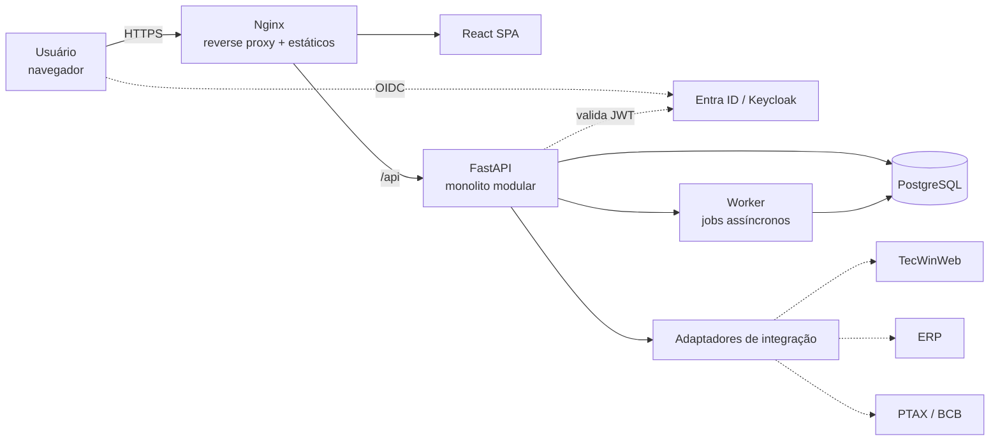
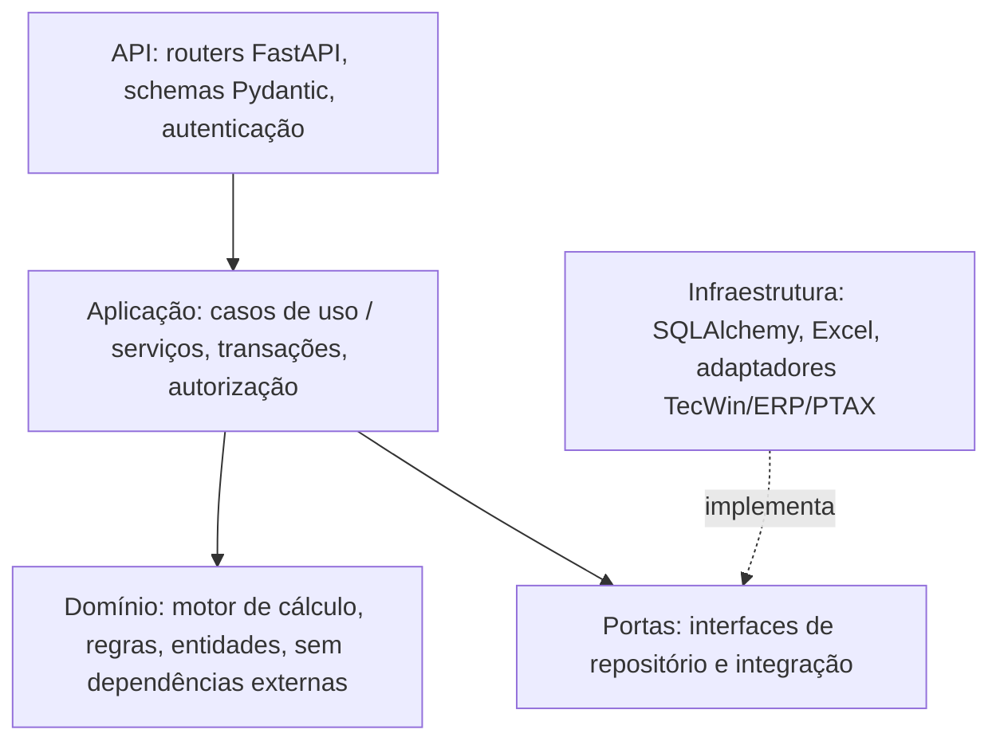

# 05. Arquitetura e Tecnologias

## 1. Avaliação da stack proposta: FastAPI + React + PostgreSQL

É uma boa escolha para este sistema. A recomendação é seguir com ela, com alguns ajustes.

Por que encaixa:
- Python é forte em cálculo com `Decimal`, geração de Excel (openpyxl/XlsxWriter) e eventual análise de dados (previsto × realizado).
- FastAPI + Pydantic v2 dão validação rigorosa de entrada e OpenAPI automática, que ajuda nas integrações futuras com ERP e TecWin.
- PostgreSQL oferece `NUMERIC` exato, `JSONB` para snapshots e memória de cálculo, constraints de exclusão para vigências, views e materialized views para relatórios, e triggers de auditoria.
- React tem o ecossistema mais maduro para telas corporativas com muitas grades, formulários e gráficos.

Pontos de atenção:
- FastAPI é minimalista. Autenticação, RBAC, auditoria, paginação e admin são por sua conta, e isso precisa entrar na estimativa. Se o time preferir "baterias incluídas", Django + DRF (ou Django Ninja) é a alternativa equivalente em Python, com admin pronto, que serviria bem para a parametrização.
- Não é preciso usar async em tudo. O volume (dezenas a centenas de processos por mês) é baixo. SQLAlchemy síncrono é mais simples de testar e depurar. Use async só se o time já domina.
- TypeScript no frontend é obrigatório. Sem ele, a tipagem dos valores e formulários vira fonte de bugs.
- Não há necessidade de microsserviços. Um monolito modular é a arquitetura certa para este porte, e ainda permite extrair módulos depois.

## 2. Stack recomendada

| Camada | Tecnologia | Motivo |
|--------|-----------|--------|
| Frontend | React + TypeScript + Vite | Padrão de mercado, build rápido |
| UI | Ant Design ou MUI | Componentes corporativos (tabelas, formulários, date pickers) com bom suporte a acessibilidade e pt-BR |
| Estado de servidor | TanStack Query | Cache, refetch e invalidação. Dispensa Redux |
| Formulários | React Hook Form + Zod | Validação tipada, espelhando os schemas do backend |
| Grades | TanStack Table (ou AG Grid Community) | Relatórios com agrupamento e totais |
| Gráficos | Apache ECharts ou Recharts | Dashboard |
| Cliente API | Gerado a partir do OpenAPI (orval ou openapi-typescript) | Contrato único entre front e back |
| Backend | Python 3.12+ / FastAPI / Pydantic v2 | Validação e OpenAPI |
| ORM / migrações | SQLAlchemy 2.x + Alembic | Maduro e explícito |
| Fórmulas | Avaliador AST restrito próprio ou `simpleeval` | Segurança (sem `eval`) |
| Excel | XlsxWriter (geração) / openpyxl (leitura de planilhas legadas) | Formatação numérica real |
| Jobs | Início: BackgroundTasks / APScheduler. Depois: Celery ou Dramatiq + Redis | Recálculo em lote e exportações grandes |
| Banco | PostgreSQL 16+ | Requisitos acima |
| Autenticação | OIDC com Microsoft Entra ID (se a empresa usa M365) ou Keycloak | SSO, MFA e grupos corporativos |
| Testes | pytest, Hypothesis, Vitest, Testing Library, Playwright | Unidade, propriedade, componente e E2E |
| Qualidade | Ruff, mypy, ESLint, Prettier, pre-commit | Padrão automatizado |
| Infra | Docker, Nginx (reverse proxy), CI no GitHub Actions ou Azure DevOps | Portabilidade on-premise ou nuvem |
| Observabilidade | Logs JSON (structlog), OpenTelemetry, Sentry | Rastreio de erros e correlation-id |

## 3. Arquitetura lógica



### 3.1 Camadas internas (Clean / Hexagonal simplificada)



Regra de dependência: o domínio não importa nada de FastAPI nem de SQLAlchemy. O motor de cálculo é testado sem banco.

### 3.2 Módulos

| Módulo | Responsabilidade |
|--------|------------------|
| `identidade` | Usuários, perfis, permissões, integração com IdP |
| `cadastros` | Tipos, moedas, cotações, transportadoras, despachantes, terminais |
| `parametros` | Parâmetros, alíquotas, componentes, fórmulas (com vigência e aprovação) |
| `importacoes` | Processo de importação e ciclo de vida |
| `calculo` | Motor (domínio), orquestração, versões, simulações |
| `provisao` | Views de provisão, competência, fechamento |
| `relatorios` | Consultas analíticas, dashboard, exportação Excel |
| `auditoria` | Trilha técnica e eventos de negócio |
| `integracoes` | Adaptadores externos (fase 2+) |

Os módulos se comunicam por serviços de aplicação, sem acessar tabelas uns dos outros. Isso permite extrair um módulo no futuro sem reescrita.

## 4. Estrutura de repositório sugerida

```
forecast/
├── backend/
│   ├── app/
│   │   ├── core/              # config, db, segurança, logging, auditoria
│   │   ├── modules/
│   │   │   ├── importacoes/   # router.py, schemas.py, service.py, repository.py, models.py
│   │   │   ├── calculo/
│   │   │   │   ├── engine/    # domínio puro: pipeline, avaliador, competência
│   │   │   │   └── ...
│   │   │   ├── parametros/
│   │   │   ├── provisao/
│   │   │   ├── relatorios/
│   │   │   ├── identidade/
│   │   │   └── auditoria/
│   │   ├── integrations/      # tecwin/, erp/, ptax/
│   │   └── main.py
│   ├── migrations/            # Alembic
│   ├── tests/
│   │   ├── unit/
│   │   ├── golden/            # casos reais das planilhas
│   │   └── integration/
│   └── pyproject.toml
├── frontend/
│   ├── src/
│   │   ├── api/               # cliente gerado do OpenAPI
│   │   ├── features/          # importacoes/, calculo/, provisao/, parametros/, dashboard/, admin/
│   │   ├── components/
│   │   ├── auth/
│   │   └── routes/
│   └── package.json
├── docs/                      # esta documentação + ADRs
├── docker-compose.yml
└── .github/workflows/
```

## 5. API REST (principais recursos)

| Método | Rota | Descrição |
|--------|------|-----------|
| GET/POST | `/api/v1/importacoes` | Listar (filtros, paginação) / criar |
| GET/PUT | `/api/v1/importacoes/{id}` | Detalhar / editar (header `If-Match` com versão) |
| POST | `/api/v1/importacoes/{id}/cancelar` | Cancelar com motivo |
| POST | `/api/v1/importacoes/{id}/calculos/previa` | Calcular sem gravar (retorna diff) |
| POST | `/api/v1/importacoes/{id}/calculos` | Gravar nova versão oficial |
| GET | `/api/v1/importacoes/{id}/calculos` | Histórico de versões |
| GET | `/api/v1/calculos/{id}` | Versão com memória de cálculo |
| POST | `/api/v1/simulacoes` | Simular cenário (com ou sem processo base) |
| POST | `/api/v1/calculos/lote/impacto` / `/lote` | Avaliar impacto / recalcular em lote |
| GET/POST | `/api/v1/parametros`, `/aliquotas`, `/formulas` | Parametrização com vigência |
| POST | `/api/v1/formulas/{id}/testar`, `/aprovar`, `/publicar` | Ciclo de vida da fórmula |
| GET | `/api/v1/provisoes?agrupar=competencia,componente` | Provisões (mensal, por DI, por tipo) |
| GET | `/api/v1/provisoes/export.xlsx` | Exportação Excel |
| POST | `/api/v1/competencias/{mes}/fechar`, `/reabrir` | Fechamento |
| GET | `/api/v1/dashboard/indicadores` | KPIs |
| GET | `/api/v1/auditoria` | Trilha de auditoria |

Convenções: versionamento na URL (`/v1`), erros em RFC 9457 (Problem Details), valores monetários serializados como string decimal (`"152340.55"`) para não perder precisão no JSON, datas em ISO 8601.

## 6. Segurança

- SSO via OIDC (Authorization Code + PKCE no SPA). O backend valida o JWT (assinatura, `aud`, `exp`).
- Autorização por permissão em cada endpoint (dependência FastAPI `require("importacao:editar")`) e verificação de regra de negócio no serviço (ex.: competência fechada).
- Princípio do menor privilégio no banco: usuário da aplicação sem DDL. Usuário de migração separado.
- Segredos em cofre (Azure Key Vault, AWS Secrets Manager ou variáveis do orquestrador), nunca no repositório.
- Cabeçalhos de segurança (CSP, HSTS), CORS restrito, rate limiting básico.
- Sem endpoints anônimos, exceto `/health`.
- Dependências verificadas no CI (pip-audit, npm audit, Dependabot/Renovate) e versões fixadas (lockfiles).

## 7. Implantação

| Ambiente | Uso | Dados |
|----------|-----|-------|
| DEV | Desenvolvimento | Sintéticos |
| HML | Homologação com usuários-chave e período paralelo | Cópia anonimizada ou reais controlados |
| PRD | Produção | Reais |

Opções de hospedagem: VM on-premise com Docker Compose (mais simples), ou nuvem com container gerenciado (Azure Container Apps / AWS ECS) + PostgreSQL gerenciado (Azure Database for PostgreSQL / RDS), com backup e PITR nativos.

## 8. Decisões de arquitetura (ADRs iniciais)

| ADR | Decisão |
|-----|---------|
| 001 | Monolito modular, não microsserviços |
| 002 | Motor de cálculo como domínio puro, com fórmulas em expressão restrita |
| 003 | Cálculos imutáveis e versionados, com snapshot JSONB |
| 004 | Parâmetros com vigência temporal e constraint de não sobreposição |
| 005 | Auditoria por trigger no PostgreSQL com contexto de usuário via `set_config` |
| 006 | Valores monetários como `NUMERIC`/`Decimal` e serializados como string |
| 007 | SSO OIDC corporativo. Sem gestão de senha local |
| 008 | Contrato de API OpenAPI-first com cliente TS gerado |
