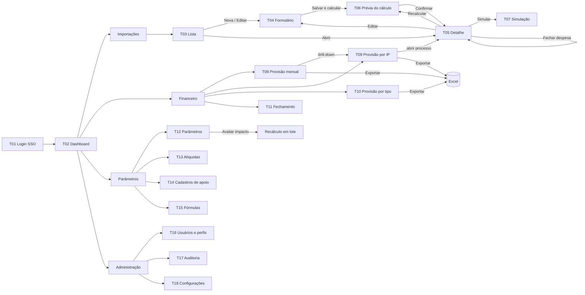

# 07. Telas e Fluxo de Navegação

## 1. Mapa de telas

| ID | Tela | Perfis | Release |
|----|------|--------|---------|
| T01 | Login (redirect SSO) | Todos | MVP |
| T02 | Dashboard | Todos | MVP (básico) |
| T03 | Lista de importações | PCM, Fin, Admin | MVP |
| T04 | Cadastro / edição de importação | PCM | MVP |
| T05 | Detalhe da importação (resumo, memória, versões, auditoria) | Todos | MVP |
| T06 | Prévia de cálculo / confirmação de recálculo | PCM | MVP |
| T07 | Simulação de cenários | PCM, Fin | R1 |
| T08 | Provisão mensal | PCM, Fin | MVP |
| T09 | Provisão por IP | PCM, Fin | MVP |
| T10 | Provisão por tipo de importação | PCM, Fin | MVP |
| T11 | Fechamento de competência | Fin, Admin | R1 |
| T12 | Parâmetros gerais (com vigência) | PCM, Admin | MVP |
| T13 | Alíquotas de impostos | PCM, Admin | MVP |
| T14 | Transportadoras / despachantes / terminais | PCM, Admin | MVP |
| T15 | Componentes e fórmulas (editor, teste, aprovação) | Admin | R1 |
| T16 | Usuários e perfis | Admin | MVP |
| T17 | Auditoria | Fin, Admin | MVP |
| T18 | Configurações do sistema | Admin | MVP |

## 2. Navegação

Menu lateral fixo, agrupado por domínio. Os itens são exibidos conforme as permissões do usuário.



## 3. Wireframes das telas principais

### T03: Lista de importações
```
┌───────────────────────────────────────────────────────────────────────────┐
│ Importações                                          [+ Nova importação]  │
├───────────────────────────────────────────────────────────────────────────┤
│ Período [01/10/26–31/10/26]  Tipo [Todos ▾]  Status [Todos ▾]  IP [_____] │
│ Transportadora [Todas ▾]                         [Limpar] [Filtrar]       │
├──────────┬──────────────┬──────────┬──────────┬───────────┬───────────────┤
│ Processo │ IP           │ Data IP  │ Tipo     │ Status    │ Total prov.   │
├──────────┼──────────────┼──────────┼──────────┼───────────┼───────────────┤
│ IMP-0142 │ IP-26-0001   │ 16/10/26 │ Industr. │ Calculado │ R$ 98.430,12  │
│ IMP-0143 │ (prevista)   │ 25/10/26 │ Uso/Cons │ Rascunho  │ –             │
│ IMP-0144 │ 26/1234590-1 │ 03/10/26 │ Industr. │ ⚠ Desatual│ R$ 41.220,00  │
└──────────┴──────────────┴──────────┴──────────┴───────────┴───────────────┘
  ◀ 1 2 3 ▶                                    Total filtrado: R$ 139.650,12
```
O status "Desatualizado" indica dados ou parâmetros alterados depois do último cálculo. O ícone sempre vem acompanhado de texto, nunca só cor.

### T04: Formulário de importação (seções em abas ou acordeão)
```
┌─ Nova importação ─────────────────────────────────────────────────────────┐
│ [1 Dados gerais] [2 Valores e câmbio] [3 Logística] [4 Impostos] [5 Obs.] │
├───────────────────────────────────────────────────────────────────────────┤
│ 2 Valores e câmbio                                                        │
│  Invoice   [  250.000,00 ] Moeda [CNY ▾]   Taxa CNY [ 0,7512 ] (PTAX ↻)   │
│  Frete     [    4.800,00 ] Moeda [USD ▾]   Taxa USD [ 5,4210 ]            │
│  Seguro    [        0,00 ] Moeda [USD ▾]                                  │
│  Siscomex  [      154,23 ]                                                │
│  ┌ Prévia em BRL ───────────────────────────────────────────────┐         │
│  │ Invoice R$ 187.800,00 · Frete R$ 26.020,80 · CIF R$ 213.975,03│         │
│  └──────────────────────────────────────────────────────────────┘         │
├───────────────────────────────────────────────────────────────────────────┤
│                         [Cancelar] [Salvar rascunho] [Salvar e calcular]  │
└───────────────────────────────────────────────────────────────────────────┘
```

### T05: Detalhe da importação
```
┌─ IMP-0142 · IP-26-0001      · Industrialização · Marítimo ── [Calculado] ─┐
│ [Editar] [Recalcular] [Simular] [Fechar despesa] [Cancelar] [Exportar]    │
├───────────────────────────────────────────────────────────────────────────┤
│ [Resumo] [Memória de cálculo] [Versões (3)] [Auditoria]                   │
├───────────────────────────────────────────────────────────────────────────┤
│ Componente              │ Base         │ Alíq./Regra │ Valor      │ Comp. │
│ CIF (base)              │              │             │ 213.975,03 │  –    │
│ II                      │ 213.975,03   │ 0,00%       │       0,00 │ 10/26 │
│ PIS                     │ 213.975,03   │ x,xx%       │   x.xxx,xx │ 10/26 │
│ ...                     │              │             │            │       │
│ TCIF                    │ 12 itens     │ 45 + 245    │     785,00 │ 11/26 │
│ Transporte local        │ 2 cont.      │ 1.500+0,06% │   3.128,39 │ 10/26 │
│ Despachante             │ 1 IP         │ Industr.    │     715,00 │ 10/26 │
├─────────────────────────┴──────────────┴─────────────┴────────────┴───────┤
│ Total provisionado: R$ 98.430,12   Versão 3 · 17/10/26 14:02 · j.silva    │
└───────────────────────────────────────────────────────────────────────────┘
```
Ao clicar em um componente, abre o painel lateral com a fórmula, as variáveis, a origem dos parâmetros e a vigência.

"Fechar despesa" abre um diálogo com valor da fatura e número da fatura (ambos obrigatórios) e só aparece para processo calculado e sem recálculo pendente. Depois do fechamento, o status vira "Fechado", os botões Editar, Recalcular e Cancelar processo somem e o detalhe mostra a fatura, a data e quem fechou. Isso é o fechamento da despesa do processo, diferente do fechamento de competência (T11).

### T07: Simulação
```
┌─ Simulação · base IMP-0142 v3 ────────────────────────────────────────────┐
│ Variáveis                  │ Componente        │ Vigente  │ Cenário │ Δ   │
│ Taxa USD [5,4210] → [5,90] │ CIF               │ 213.975  │ 216.274 │ +1% │
│ Taxa CNY [0,7512] → [0,75] │ ICMS              │  …       │  …      │ …   │
│ Containers [2] → [3]       │ Transp. local     │ 3.128    │ 4.628   │ +48%│
│ Alíq. ICMS [..] → [..]     │ TOTAL             │ 98.430   │ 101.9xx │+3,5%│
│ [Restaurar] [Salvar cenário] [Exportar] [Promover ao processo]            │
└───────────────────────────────────────────────────────────────────────────┘
```

### T08: Provisão mensal
```
┌─ Provisão mensal ── Competência [10/2026] a [12/2026]  Tipo [Todos ▾] ────┐
│ Componente            │   10/2026   │   11/2026   │   12/2026   │ Total   │
│ Impostos (II..ICMS)   │  412.300,00 │  198.110,00 │   50.000,00 │ …       │
│ TCIF                  │    2.340,00 │    3.115,00 │      980,00 │ …       │
│ Transportes           │   18.200,00 │    9.430,00 │    4.100,00 │ …       │
│ Armazenagem           │   11.050,00 │    6.700,00 │    2.010,00 │ …       │
│ Despachante           │    7.330,00 │    4.330,00 │    1.615,00 │ …       │
│ Frete internacional   │   …         │   …         │   …         │ …       │
│ TOTAL                 │ …           │ …           │ …           │ …       │
│ 10/2026: 🔒 Fechada em 03/11/26 por m.souza       [Exportar Excel]        │
└───────────────────────────────────────────────────────────────────────────┘
```
Os grupos se expandem por componente. Clicar em uma célula leva à T09 filtrada.

### T12: Parâmetros com vigência
```
┌─ Parâmetros ── [Buscar parâmetro ____]  Escopo [Todos ▾] ─────────────────┐
│ Chave                  │ Escopo         │ Valor vigente │ Desde    │ Ações │
│ tcif.valor_item        │ Global         │ R$ 45,00      │ 01/01/26 │ [Nova vigência] [Histórico] │
│ despachante.honorario  │ Industrializ.  │ R$ 715,00     │ 01/01/26 │ ...   │
│ despachante.honorario  │ Uso e Consumo  │ R$ 900,00     │ 01/01/26 │ ...   │
│ competencia.dia_corte  │ Global         │ 15            │ 01/01/26 │ ...   │
└───────────────────────────────────────────────────────────────────────────┘
```
"Nova vigência" pede valor, data de início e justificativa. Depois de salvar, a tela oferece "Avaliar impacto nos processos abertos".

## 4. Diretrizes de UX

- Valores monetários alinhados à direita, com fonte tabular e formato pt-BR.
- Os campos de moeda aceitam colagem do Excel (`1.234,56` e `1234.56`).
- Sempre indicar a origem de um valor (parâmetro, override, manual) com ícone + tooltip + texto acessível.
- Confirmação explícita em ações irreversíveis (cancelar processo, fechar competência), com campo de motivo.
- Estados vazios, de carregamento e de erro definidos em todas as telas.
- Acessibilidade: navegação completa por teclado, foco visível, rótulos associados, contraste AA e status não comunicado só por cor.
