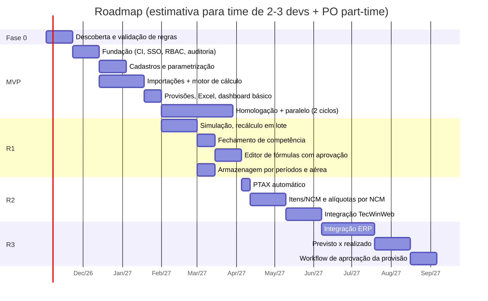

# 08. MVP e Roadmap

## 1. Objetivo do MVP

Substituir a planilha no cálculo e na provisão mensal, com resultado idêntico ao da planilha validada, rastreável e auditável. O MVP não busca todas as funcionalidades. O foco é eliminar a planilha no fluxo principal.

## 2. Escopo do MVP

| Incluído | Fora do MVP |
|----------|-------------|
| SSO + perfis PCM, Financeiro e Admin | Editor de fórmulas com aprovação (no MVP as fórmulas v1 são seed versionado via migração/PR) |
| Auditoria técnica (trigger) + consulta | Simulação de cenários |
| Cadastros: tipos, moedas, transportadoras, despachantes, terminais | Fechamento de competência (no MVP o export mensal é guardado como evidência) |
| Parâmetros e alíquotas com vigência (entrada manual) | Recálculo em lote |
| Cadastro, edição, consulta e cancelamento de importação | Integrações TecWin, ERP e PTAX |
| Motor de cálculo com todos os componentes definidos (armazenagem aérea com valor manual) | Itens/NCM |
| Versionamento de cálculo + memória + histórico | Previsto × realizado |
| Provisão mensal, por DI e por tipo + Excel | Dashboard avançado |
| Dashboard básico (importações/mês, valor provisionado, por tipo, evolução) | |
| Carga inicial dos processos em aberto | |

Critério de saída do MVP: dois ciclos mensais em paralelo com a planilha, divergência zero (tolerância de R$ 0,01 por componente) ou divergências explicadas e aceitas pelo PCM/Fiscal, e aceite formal do Financeiro.

## 3. Roadmap

As datas são ilustrativas e dependem do tamanho do time, da disponibilidade dos usuários-chave e das respostas aos pontos em aberto (doc 01, seção 7).

| Fase | Entrega de valor |
|------|------------------|
| Fase 0: Descoberta | Planilhas mapeadas, fórmulas validadas com o Fiscal, 20 a 30 golden cases, respostas aos pontos em aberto, protótipo navegável das telas T03–T05 e T08 |
| MVP | Fim da planilha no cálculo e na provisão, histórico e auditoria |
| R1: Análise e controle | Simulações, governança de fórmulas, fechamento mensal formal |
| R2: Automação de insumos | Câmbio e alíquotas automáticos, granularidade por NCM |
| R3: Integração e inteligência | Provisão enviada ao ERP, comparação com o realizado para melhorar a acurácia e a aprovação formal |
| Contínuo | Adequação à Reforma Tributária (CBS/IBS) e à DUIMP conforme o calendário legal |
