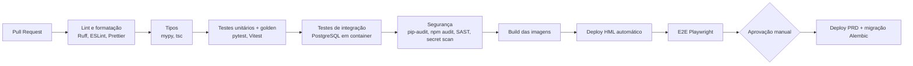

# 10. Governança Corporativa e Boas Práticas de Engenharia

## 1. Governança do produto

### 1.1 Papéis

| Papel | Quem (sugestão) | Responsabilidade |
|-------|-----------------|------------------|
| Patrocinador | Gerência de Supply/PCM ou Controladoria | Prioridades, orçamento, aceite final |
| Product Owner | Analista sênior do PCM | Backlog, regras de negócio, aceite das histórias |
| Dono das regras fiscais | Fiscal/Tributário | Valida alíquotas, bases e fórmulas de impostos |
| Dono da provisão | Financeiro/Controladoria | Valida relatórios e fechamento |
| Tech lead / arquiteto | TI | Arquitetura, qualidade, segurança |
| Time de desenvolvimento | TI / fornecedor | Implementação e testes |
| Segurança da Informação | TI | Revisão de acesso, conformidade |

### 1.2 Matriz RACI (R = executa, A = aprova, C = consultado, I = informado)

| Atividade | PCM/PO | Fiscal | Financeiro | Admin TI | Tech lead | Patrocinador |
|-----------|--------|--------|------------|----------|-----------|--------------|
| Definir/alterar regra de cálculo | R | A | C | I | C | I |
| Alterar alíquotas | R | A | I | I | – | – |
| Alterar parâmetros operacionais (fretes, despachante) | R/A | I | I | – | – | – |
| Publicar fórmula no sistema | C | A | I | R | C | – |
| Fechar competência | I | – | R/A | – | – | I |
| Reabrir competência | C | – | R | – | – | A |
| Conceder acesso | C | – | C | R | – | A (perfis sensíveis) |
| Liberar versão em produção | A | I | I | R | R | I |

### 1.3 Gestão de mudanças de regras
- Toda mudança de fórmula, alíquota ou parâmetro tem vigência, justificativa e autor registrados.
- Fórmulas e regras de impostos seguem o princípio dos 4 olhos: quem cria não aprova.
- Antes de publicar, rodar a análise de impacto sobre os processos abertos e anexar o resultado.
- Mudanças retroativas (vigência no passado) exigem permissão específica e aprovação do dono da regra.

### 1.4 Controles internos (alinhados a práticas tipo SOX/COSO)
- Segregação de funções: quem cadastra processo não fecha competência, e quem cria fórmula não aprova.
- Trilha de auditoria imutável, com retenção definida por Compliance.
- Revisão trimestral de acessos (relatório de usuários × perfis).
- Evidência mensal: snapshot da provisão no fechamento, exportável.
- Reprodutibilidade: qualquer cálculo pode ser refeito a partir do snapshot, com hash de integridade.

## 2. Processo de engenharia

### 2.1 Método
- Scrum ou Kanban com sprints de 2 semanas e demo quinzenal para os usuários-chave.
- Refinamento semanal com PO e Fiscal enquanto houver pontos em aberto.
- DoR/DoD conforme o doc 06.

### 2.2 Código e versionamento
- Trunk-based development com branches curtas (`feat/`, `fix/`, `chore/`) e PRs pequenos.
- Proteção da `main`: PR obrigatório, 1 aprovação (2 para o motor de cálculo e a segurança), CI verde.
- Conventional Commits + versionamento semântico das releases + CHANGELOG gerado.
- ADRs em `docs/adr/` para toda decisão estrutural.

### 2.3 Pipeline CI/CD

### 2.4 Qualidade
- Cobertura: ≥ 90% no `calculo/engine`, ≥ 70% no geral, medida no CI.
- Golden tests obrigatórios: qualquer mudança no motor que altere um caso de referência quebra o build até que o caso seja atualizado com aprovação do PO/Fiscal.
- Migrações de banco revisadas, reversíveis quando possível, e testadas em cópia de HML.
- Testes de contrato: o cliente TS é regenerado do OpenAPI no CI, e uma divergência quebra o build.

### 2.5 Segurança e privacidade
- OWASP ASVS nível 2 como checklist e OWASP Top 10 no code review.
- Dependências com versões fixadas (lockfiles: `uv.lock`/`poetry.lock`, `package-lock.json`) e atualizações via Renovate/Dependabot.
- Segredos fora do repositório, com rotação periódica.
- LGPD: dados pessoais só dos usuários (nome, e-mail). Registrar no inventário de dados (ROPA) e aplicar minimização.
- Pentest ou revisão de segurança antes do go-live.

### 2.6 Operação
- Ambientes DEV, HML e PRD isolados, com infraestrutura como código quando em nuvem.
- Backup diário + PITR, com teste de restauração trimestral documentado.
- Observabilidade: logs estruturados com `correlation_id`, métricas (latência, erros, cálculos/dia), alertas para erros 5xx e falhas de job.
- Health checks (`/health/live`, `/health/ready`).
- Runbook de incidentes e de reabertura de competência.

### 2.7 Documentação viva
- Esta pasta `docs/` versionada junto com o código.
- OpenAPI publicado em HML (Swagger UI restrito a usuários autenticados).
- Dicionário de variáveis e fórmulas gerado a partir do banco (fonte única).
- Manual do usuário curto por perfil + vídeos de 2 a 3 minutos por fluxo principal.
